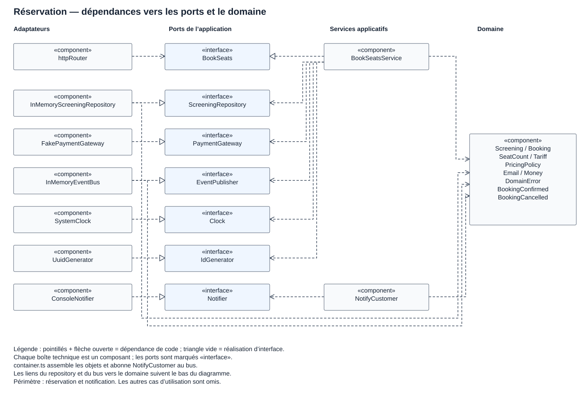
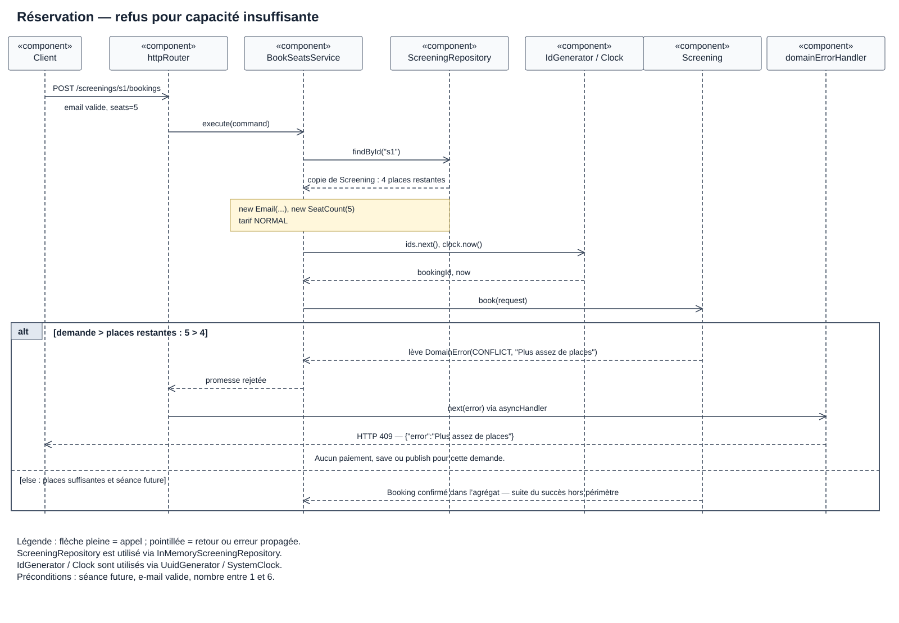

# Document d'architecture technique — CinéResa

## 1. Contexte et objectifs

CinéResa permet à un client de consulter les séances d'un cinéma, de réserver des places puis de consulter ou d'annuler ses réservations. L'utilisateur passe par une API HTTP, par exemple avec Postman. L'adresse e-mail sert à retrouver ses réservations, sans authentification.

Le projet part d'une application legacy. L'objectif est de séparer les règles de réservation des détails techniques pour pouvoir tester le métier et remplacer un adaptateur plus facilement.

Le périmètre comprend les séances déjà disponibles, les réservations, les tarifs et les annulations. La gestion du catalogue, une interface graphique, un vrai paiement et l'envoi réel d'e-mails sont hors périmètre. Le stockage est en mémoire.

## 2. Contraintes et exigences

### Scénario de qualité : refuser une réservation sans modifier les places

| Élément | Scénario |
|---|---|
| Source | Un client qui utilise l'API de réservation. |
| Stimulus | Il demande 5 places alors qu'il n'en reste que 4 sur la séance. |
| Environnement | Application locale démarrée, séance future, requêtes traitées successivement et dépendances fonctionnelles. |
| Artefact | `BookSeatsService`, `Screening.book()` et l'adaptateur HTTP. |
| Réponse | Le domaine lève `DomainError("CONFLICT", "Plus assez de places")`. Le service interrompt le traitement et HTTP renvoie 409. Aucun paiement, enregistrement ni événement de confirmation n'est déclenché pour cette demande. |
| Mesure | Sur 10 tentatives successives identiques : 10 réponses 409, toujours 4 places restantes, 0 appel à `PaymentGateway.charge`, 0 appel à `ScreeningRepository.save` et 0 publication via `EventPublisher` pour ces demandes. |

Cette mesure est un critère à vérifier, pas un résultat de test déjà obtenu. Le test « protège l'invariant de capacité » dans `test/Screening.test.ts` couvre la règle au niveau du domaine. Il faudrait compléter avec un test HTTP et des espions sur les ports pour vérifier tout le scénario.

Le code est en TypeScript, avec Express côté HTTP. Les prix sont des entiers en centimes. Les règles principales sont de réserver entre 1 et 6 places, de respecter la capacité et de permettre l'annulation jusqu'à 2 heures avant la séance, limite exacte incluse.

## 3. Glossaire

| Terme du métier | Définition | Nom dans le code |
|---|---|---|
| Séance | Projection d'un film à une date, dans une salle, avec une capacité et un prix. Racine de l'agrégat. | `Screening` |
| Réservation | Places réservées pour une séance et une adresse e-mail. | `Booking` |
| Nombre de places | Entier de 1 à 6 ; un groupe commence à 4 places. | `SeatCount` |
| Adresse e-mail | Adresse validée, passée en minuscules et sans espaces aux extrémités. | `Email` |
| Montant | Valeur monétaire entière et positive ou nulle en centimes. | `Money` |
| Tarif | Tarif normal ou étudiant. | `Tariff` (`NORMAL`, `STUDENT`) |
| Règle de prix | Calcul des réductions étudiant et groupe. | `PricingPolicy` |
| État de réservation | Réservation confirmée ou annulée. | `BookingStatus` (`CONFIRMED`, `CANCELLED`) |
| Places restantes | Capacité moins les places des réservations confirmées. | `Screening.remainingSeats()` |
| Confirmation | Événement produit lors de la création d'une réservation dans l'agrégat. | `BookingConfirmed` |
| Annulation | Événement produit quand une réservation est annulée. | `BookingCancelled` |
| Refus métier | Erreur signalant qu'une opération ne peut pas aboutir. | `DomainError` |

## 4. Vue logique

### 4.1 Style d'architecture

Le projet utilise une architecture hexagonale avec quelques éléments de DDD tactique : agrégat, entités, objets-valeur et événements métier.

- Le domaine contient `Screening`, `Booking`, les objets-valeur et le calcul du prix. Il ne connaît pas Express.
- L'application orchestre les opérations. Par exemple, `BookSeatsService` charge la séance, appelle le domaine, demande le paiement, sauvegarde puis publie les événements.
- Les ports entrants définissent les cas d'utilisation. Les ports sortants définissent les besoins techniques de l'application.
- Les adaptateurs assurent HTTP, stockage en mémoire, paiement simulé, notifications console, horloge, identifiants et événements.

`container.ts` assemble les objets dans `buildApp()` et abonne `NotifyCustomer` aux événements du bus. `main.ts` démarre le serveur. Les services renvoient des DTO pour ne pas exposer directement les objets du domaine.

`Booking` reste une entité à l'intérieur de `Screening`. Le choix est détaillé dans l'[ADR-001](adr/001-booking-dans-screening.md).

### 4.2 Diagramme de composants UML

Question : de quels ports et composants dépend le traitement d'une réservation ? Le diagramme se concentre sur `BookSeats`, avec la notification qui suit la confirmation.

[Source PlantUML](diagrams/composants.puml)

Les flèches pointillées indiquent des dépendances de code, pas l'ordre des appels. Les réalisations d'interface vont de l'implémentation vers le port. Les ports appartiennent à l'application ; les dépendances vers le domaine pointent vers le cœur métier.

### 4.3 Correspondance avec les fichiers

Les chemins ci-dessous sont ceux de la version fournie, y compris ses différences de nommage.

| Élément | Fichier ou dossier sous `src/` |
|---|---|
| Adaptateur HTTP | `adapters/in/http/httpRouter.ts`, `domainErrorHandler.ts` |
| Service de réservation | `application/usecase/BookSeatsService.ts` |
| Ports entrants | `application/ports/in/` |
| Ports sortants | `application/ports/out/` |
| Agrégat et règles | `domain/booking/Screening.ts`, `Booking.ts`, `PricingPolicy.ts`, `SeatCount.ts`, `Tariff.ts` |
| Objets partagés | `domain/shared/` |
| Stockage | `adapters/out/persistence/InMemoryScreeningRepository.ts` |
| Paiement | `adapters/out/payment/FakePaymentGateway.ts` |
| Événements | `adapters/out/events/InMemoryEventBus.ts`, `domain/booking/events.ts` |
| Notifications | `application/handlers/NotifyCustomer.ts`, `adapters/out/notification/ConsoleNotifier.ts` |
| Horloge et identifiants | `adapters/out/system/SystemClock.ts`, `UuidGenerator.ts` |

Les imports dans `container.ts` visent actuellement un dossier `usecases` inexistant. Les noms des fichiers de deux autres services ne correspondent pas non plus à leurs imports. Ces écarts de chemins doivent être corrigés pour exécuter l'application ; ils ne changent pas les responsabilités décrites ici.

## 5. Vue dynamique : un cas d'erreur

Question : que se passe-t-il si le client demande plus de places qu'il n'en reste ?

Une séance future possède 4 places restantes. Le client demande 5 places, avec une adresse valide. Le nombre 5 est autorisé par `SeatCount`, mais pas par la capacité restante de cette séance.

[Source PlantUML](diagrams/reservation-refusee.puml)

Le repository renvoie une copie de l'agrégat. `BookSeatsService` construit les objets-valeur, obtient un identifiant et l'heure, puis appelle `Screening.book()`. La branche d'erreur du fragment `alt` lève `DomainError`. Le wrapper `asyncHandler` transmet l'erreur à `domainErrorHandler`, qui répond avec le statut 409.

La vérification de capacité a lieu avant la création de `Booking`. Cette branche ne passe donc ni par le paiement, ni par la sauvegarde, ni par la publication d'événements. La branche alternative indique seulement le résultat métier si les places suffisent ; la suite du parcours de succès est hors du diagramme.

## 6. Décision d'architecture

| ADR | Titre | Statut |
|---|---|---|
| [001](adr/001-booking-dans-screening.md) | Booking dans l'agrégat Screening ou agrégat séparé ? | Accepté pour la version du TP |

Ce document décrit l'organisation du code fourni. Il ne garantit pas la gestion de requêtes concurrentes : le repository en mémoire ne possède ni verrou ni contrôle de version. Les tests et la compilation n'ont pas été exécutés pendant la rédaction.
